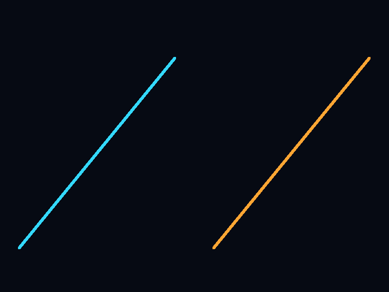
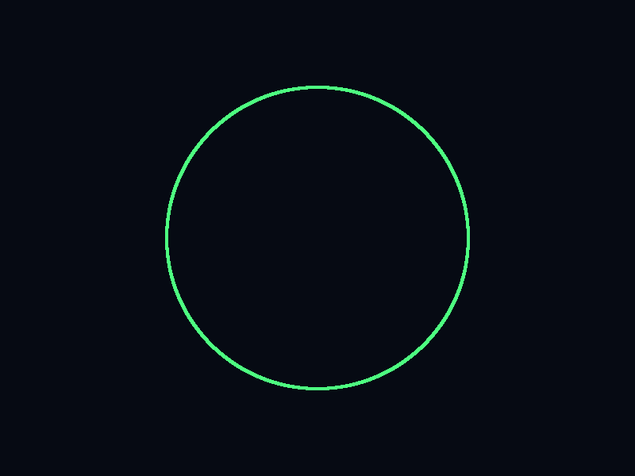
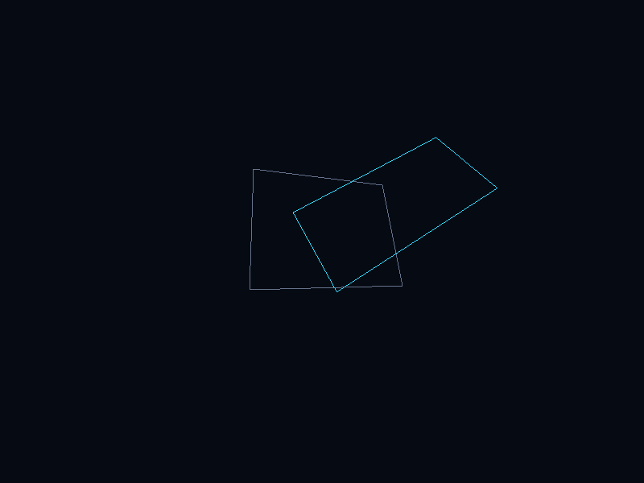
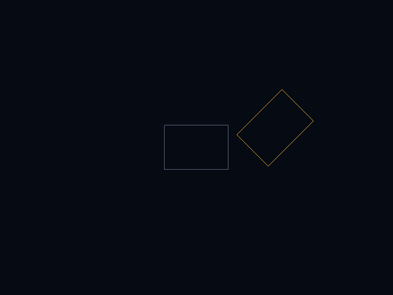
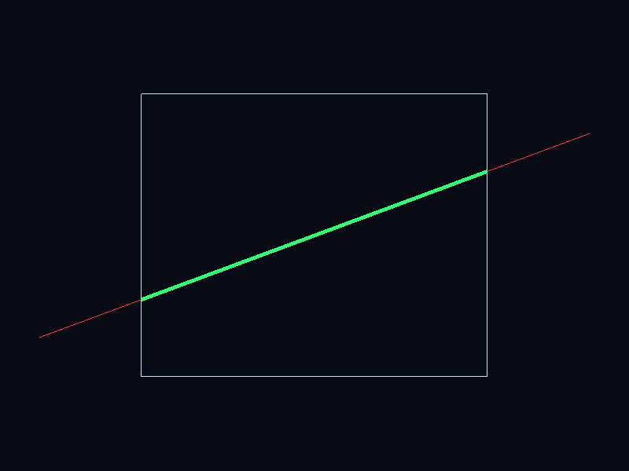
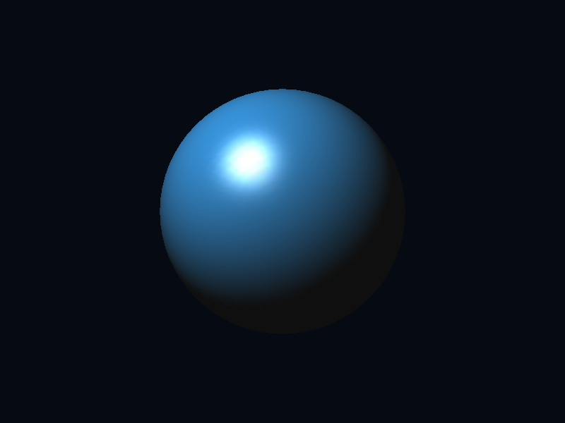
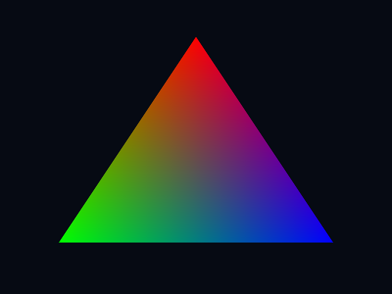
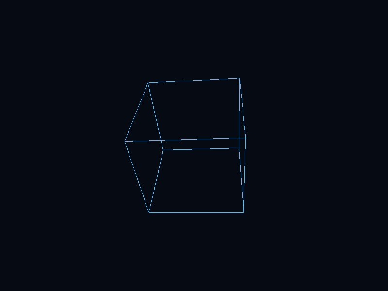

# CG & VR Lab — CS4104

Coursework for **CS4104 – Computer Graphics and Virtual Reality**, RV University.
Dhruv Kumar Lakan · 1RVU23CSE151

The repository holds the native macOS OpenGL implementations of experiments
1–8 and 10, the Unity project for experiment 9, and a small offscreen snapshot
tool used to produce the images below.

```
native_opengl/        Experiments 1-8 and 10 (C++ / OpenGL / GLUT)
Experiment09_Unity/   Experiment 9 (Unity project source)
tools/                Offscreen snapshot harness
docs/images/          Rendered output of every experiment
```

---

## Build and run

Requires macOS with the Xcode command line tools. OpenGL and GLUT ship with the
system, so there is nothing to install.

```sh
cd native_opengl
make
```

Run a single experiment, or all of them in sequence:

```sh
make run-1      # any of run-1 ... run-8, run-10
make run-all    # 1-8 then 10, six seconds each
```

`make run-all` opens one window and advances through the experiments
automatically in the order 1, 2, 3, 4, 5, 6, 7, 8, 10.

---

## Experiments

Every image below is the program's actual framebuffer at 800×600, read back
with `glReadPixels` rather than screen-captured, so what is shown is exactly
what the rasteriser produced.

### 1 — DDA and Bresenham line generation

Both incremental line algorithms drawn side by side. The DDA line (left, cyan)
accumulates a floating-point increment and rounds each step; the Bresenham line
(right, orange) uses the integer decision variable and never leaves integer
arithmetic.



### 2 — Midpoint circle algorithm

A circle of radius 190 px plotted from the midpoint decision variable, using
8-way symmetry so only one octant is actually iterated.



### 3 — 2D transformations on a polygon

The grey quadrilateral is the original. The cyan one has been translated,
rotated by 32° and scaled by (1.25, 0.75) through the fixed-function matrix
stack, showing that the transformations compose.



### 4 — Composite homogeneous transformation

The same idea done explicitly rather than through OpenGL: a 3×3 homogeneous
matrix `M = T · R` is formed by multiplying the translation and rotation
matrices by hand, then applied to each vertex of the grey square to give the
orange one. Building the composite first means each vertex costs one matrix
multiply.



### 5 — Cohen–Sutherland line clipping

The red segment is the input line and the white rectangle is the clip window.
The algorithm's region outcodes reject the parts outside the window and the
surviving portion is redrawn thick in green, exactly between the two boundary
intersections.



### 6 — Hidden surface removal with the depth buffer

Two triangles are deliberately made to interpenetrate. With `GL_DEPTH_TEST`
enabled the per-pixel depth comparison resolves the intersection correctly,
producing the clean crossing line that a painter's-algorithm sort could not.


### 7 — Phong lighting and materials

A sphere lit by a single positional light with ambient, diffuse and specular
terms and a shininess exponent of 56. The tight specular highlight and the
smooth terminator come from per-vertex lighting over a finely tessellated
sphere.



### 8 — GLSL vertex and fragment shaders

The fixed-function pipeline is replaced by a compiled shader program. The
vertex shader passes a per-vertex colour attribute through to a varying, and
the fragment shader writes it out, so the interpolation across the triangle is
performed by the rasteriser.



### 9 — Interactive 3D scene (Unity)

Experiment 9 is a Unity project rather than a native program, and lives in
[`Experiment09_Unity/`](Experiment09_Unity). Open the folder with Unity Hub and
press Play. Its scripts build the scene procedurally at runtime, so there are
no binary scene assets to import.

### 10 — Perspective projection and camera viewing

A wireframe cube viewed through a 55° perspective frustum with `gluLookAt`
placing the camera at (3, 2.5, 6). The converging edges confirm the perspective
divide, as against the orthographic projection used by experiments 1–5.



---

## Regenerating the snapshots

`tools/snapshot.cpp` includes `CGVR_OpenGLLabs.cpp` with its `main` renamed
away, so it reuses the lab's own drawing code without modifying it. It renders
each experiment once, reads the framebuffer back and writes a BMP.

```sh
clang++ -std=c++17 -DGL_SILENCE_DEPRECATION -Inative_opengl \
    tools/snapshot.cpp -framework OpenGL -framework GLUT -o tools/snapshot
./tools/snapshot docs/images 1 2 3 4 5 6 7 8 10
for f in docs/images/*.bmp; do sips -s format png "$f" --out "${f%.bmp}.png"; done
rm -f docs/images/*.bmp
```

---

## Notes

- The native program targets Apple's OpenGL and GLUT frameworks, both of which
  are deprecated on macOS but still functional; `-DGL_SILENCE_DEPRECATION`
  suppresses the warnings.
- If a copy of the binary is transferred by AirDrop it arrives with a
  `com.apple.quarantine` attribute and macOS kills it on launch. Rebuild with
  `make clean && make` rather than running the transferred binary.
- Unity's `Library/`, `Logs/` and `UserSettings/` folders are generated and are
  excluded from version control; Unity recreates them when the project is first
  opened.
